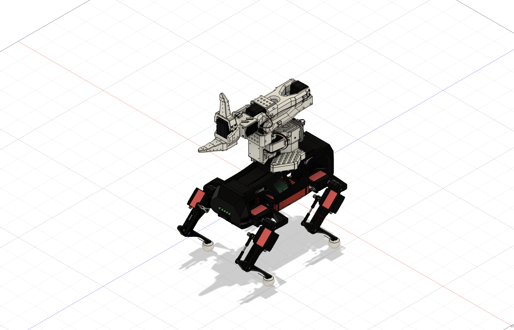

# SO-101 on a quadruped: Fusion placement study

**Status: engineering reference only. This is not a buildable walking robot.** The arm is floating above the chassis in the model; it is not attached. Do not print or operate this assembly as shown. Fusion has not verified a mounting structure, gait, payload, or strength.

## What is in the Fusion file

[Open the placement study](outputs/quadruped-so101-placement-study.f3d). It combines:

- The SO-101 follower assembly from The Robot Studio and Hugging Face, pinned in `reference/SO-ARM100`.
- The original V2 quadruped STEP assembly by Miguel Ayuso Parrilla, from the [creator's project](https://hackaday.io/project/171456-diy-hobby-servos-quadruped-robot). Its four legs and modeled servo, body, battery, controller, and fastener components are kept in the source position.

The arm has been rotated and translated into a single arbitrary pose over the quadruped. It has not been modified into a stowed pose and has no bracket, screws, clamps, support surface, battery, or control integration. Both references are STEP imports, so their native feature history and kinematic joints are not present. The combined Fusion archive was reopened successfully: it contains 15 top-level occurrences and **zero joints**. Consequently there is no motion study or swept-clearance evidence. The timeline inspection found no error or warning states; one timeline group reports an unknown state, which is expected for a group rather than a computed feature.

## What was measured

Fusion uses the imported quadruped's Y axis as vertical in this model. For this one arbitrary pose:

- The quadruped body occurrence bounds are about 112 mm across X and 250 mm along Z; its uppermost point is at Y = 65.9 mm.
- The arm occurrence bounds are X = −55.5 to +55.5 mm, Y = 70.4 to 324.2 mm, and Z = −93.6 to +226.8 mm. These are whole-assembly bounding boxes, not a reach or balance measurement.
- Fusion's minimum-distance measurement from the SO-101 base to the two bodies in the quadruped `body:1+upper:1` component was approximately **4.483 mm** and **6.210 mm**. This demonstrates a gap at the selected components and pose, not a complete interference check. It does not measure the arm against every body, attachments, wiring, or moving positions.
- A broad-phase inspection found nominal 3.2 mm diameter vertical cylindrical features in the quadruped upper body, but no hardware engagement, load path or usable mounting interface has been validated. The arm's printed base was designed for desk clamps; resting it above the top shell is not a viable structural mount by itself.

The original V2 source assembly's visual model names a DS3225MG 25 kg servo; descriptions and later configurations on the creator's project also refer to other servo variants. Do not treat the visual CAD name as a verified procurement specification. Confirm the exact source revision and all mechanical and electrical requirements before purchasing anything.

## What remains before building

1. Establish a complete mass, center-of-mass and power budget, including the actual printed arm, leg servos, battery, controller and all added hardware. Determine the arm's physical stowed pose and required stationary reach.
2. Select a quadruped and actuators on the basis of **continuous** torque, speed, current and thermal data; calculate joint loads across three-leg stance and manipulation poses. The imported reference has not been shown to carry the additional arm.
3. Design an arm mount to transfer loads into verified structural members, with accessible fasteners and a positive stow restraint. Check the actual interfaces and fasteners, not just bounding boxes. Model the selected hardware and cable routes.
4. Create and validate the 12 leg joints and the arm joints; check joint limits, fastener clearances, self-collision, walking and manipulation envelopes. A static placement cannot establish any of these.
5. Complete the power distribution and controls, including correctly sized protection and a physical motor-power disconnect; integrate and validate the gait and the arm controller. A power cut can cause collapse.
6. Print fit coupons and one leg, inspect an actual slice for the selected Bambu printer and material, then perform supported joint tests, static-load and stability tests, and progressive restrained walking tests before attaching the arm or testing manipulation.

## Provenance and terms

The quadruped source archive is `reference/quadruped-v2/source.zip`, obtained from the [preserved original STEP archive](https://models.opensourcerobotics.dev/source/4c7c8df851030f01a2c55080417495db4431f0836f3f3d97c7ec99315a08e052/diy-hobby-servos-quadruped-v2-source.step.zip); SHA-256 `4c7c8df851030f01a2c55080417495db4431f0836f3f3d97c7ec99315a08e052` matches the published receipt. The source project declares **CC BY-NC-SA 4.0 for hardware** and GPL v3 for software; component models may have separate terms. Review those restrictions before redistribution or commercial use. SO-101 attribution and license are in its own upstream repository. These are different projects, not a tested combined design.
