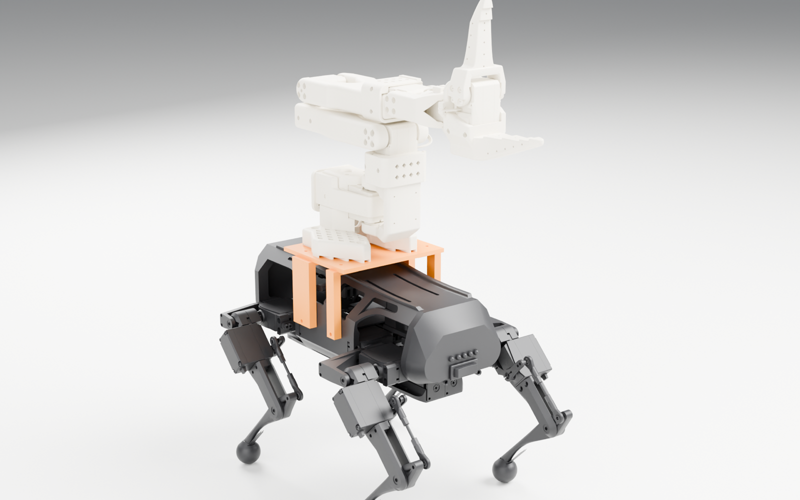
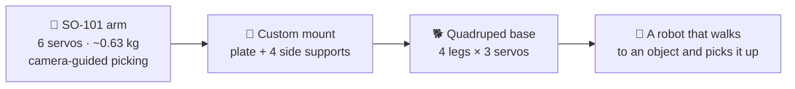
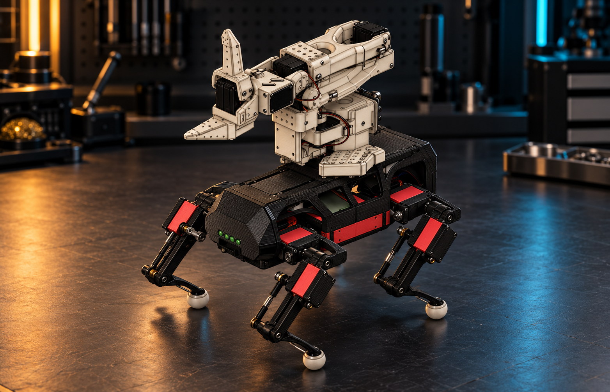
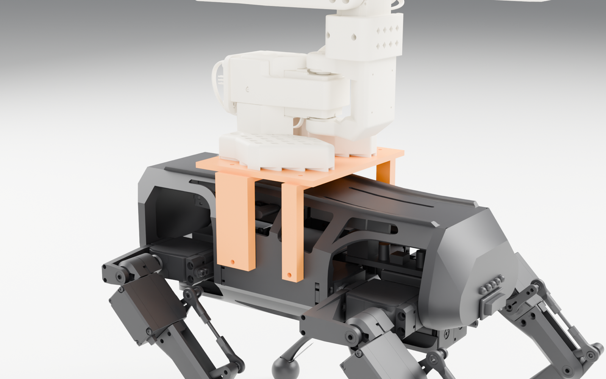
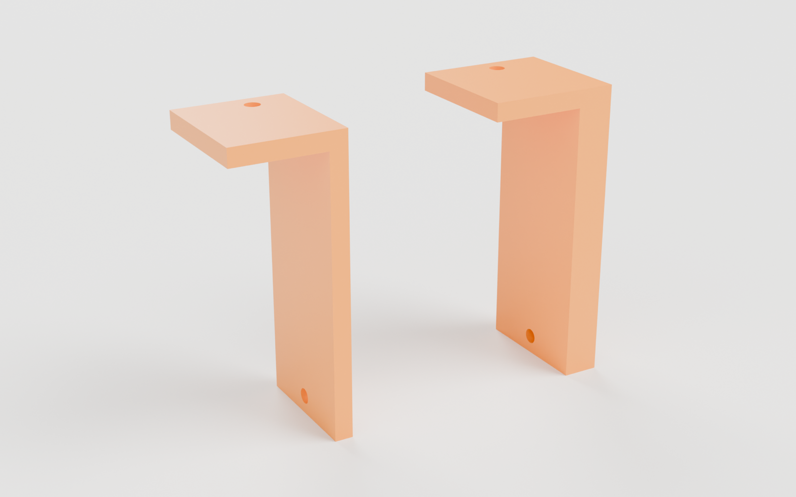
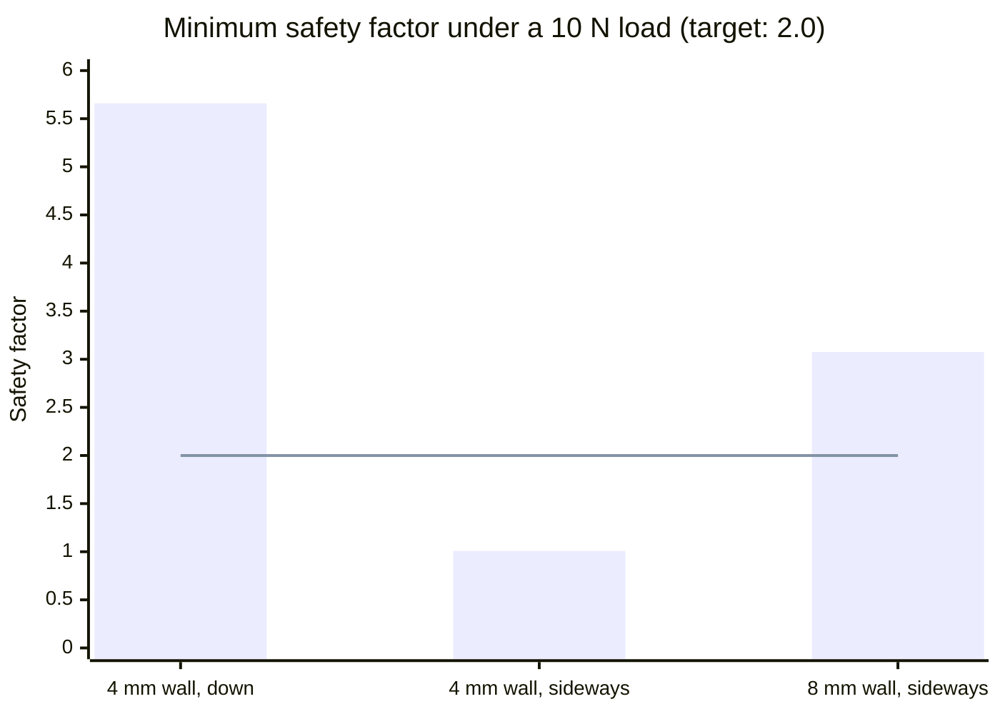
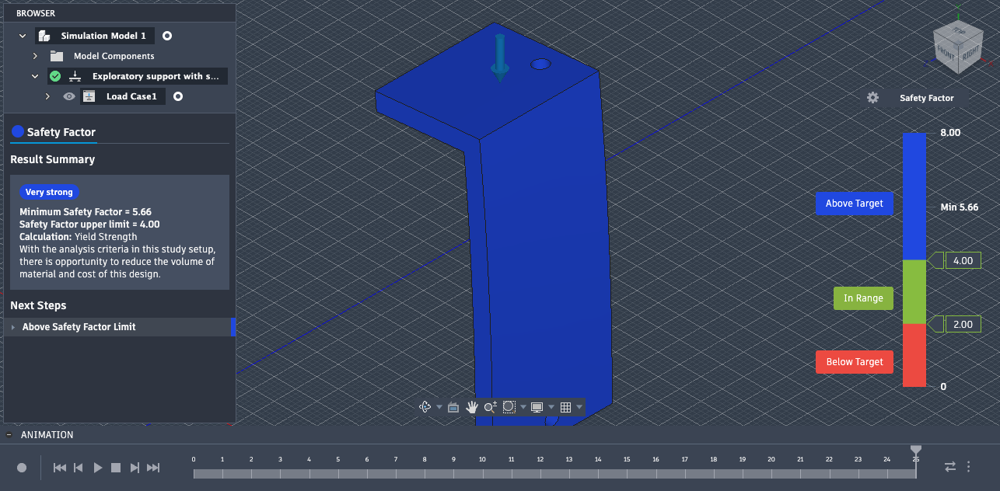
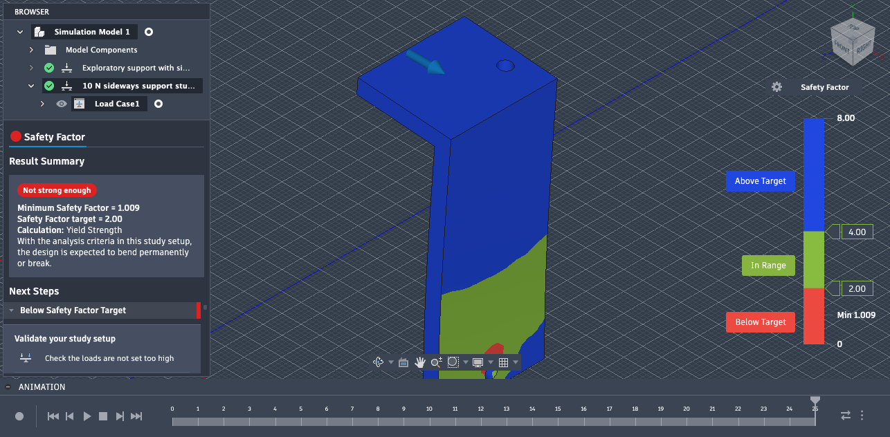
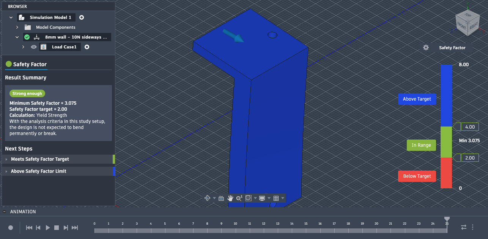

# Terra: a robot arm that walks

**Can a desk robot arm ride on a 3D-printed dog and pick things up wherever it goes?** This project is working
toward that answer in Autodesk Fusion: first a desk-mounted SO-101 arm, then a four-legged base to carry it.



> [!WARNING]
> **The walking robot is not ready to print or operate.** It has not been assembled or physically tested, and its
> mount, actuators, power, controls and gait are not validated. The images and CAD concepts are studies, not a
> completed build.

## The idea

Two open-source robots, combined: the **SO-101** arm from The Robot Studio and Hugging Face (6 servos, about 0.63 kg),
and a **12-servo hobby quadruped** by Miguel Ayuso Parrilla. The orange parts are new: a plate under the arm and four
L-shaped supports that bolt into holes the chassis already has.



## Where it stands

Each step builds evidence for the next. Green is done in CAD or on paper; the rest needs real parts.

```mermaid
flowchart LR
    S1["✅ Desk arm<br/>build guide"] --> S2["✅ Place arm<br/>on quadruped"]
    S2 --> S3["✅ Make one leg<br/>move in Fusion"]
    S3 --> S4["✅ Design mount,<br/>check bolts fit"]
    S4 --> S5["✅ Stress-test<br/>the supports"]
    S5 --> S6["⬜ Pick actuators<br/>+ power"]
    S6 --> S7["⬜ Print, assemble,<br/>test on a stand"]
    S7 --> S8["⬜ Walk, then<br/>walk and pick"]
    classDef done fill:#d1f7d6,stroke:#2da44e,color:#000
    classDef todo fill:#f6f8fa,stroke:#8c959f,color:#000
    class S1,S2,S3,S4,S5 done
    class S6,S7,S8 todo
```



## What the studies found

### The arm fits

Placed over the quadruped in Fusion, the arm's base clears the body by about 4.5 mm. That's a gap, not a mount:
the arm is floating, so the next step was to design something to hold it. [Placement study →](QUADRUPED-PLACEMENT-STUDY.md)

<table>
  <tr>
    <td width="50%"></td>
    <td width="50%"></td>
  </tr>
  <tr>
    <td align="center"><sub>The Fusion placement study</sub></td>
    <td align="center"><sub>An AI concept render made from it, to see where this is going</sub></td>
  </tr>
</table>

### One leg moves

A single leg was rebuilt in Fusion with six working joints (hip yaw, hip flex and a knee linkage) and checked for
collisions at sampled angles. The fork hits the femur when the hip swings to −15° or further, which tells the next
leg design where its limit is. [Single-leg study →](SINGLE-LEG-MOTION-STUDY.md)

### The mount

A 120 × 100 × 4 mm plate under the arm, held by four L-shaped supports that bolt into the chassis's existing side
holes. Raising it 10 mm cleared the arm's bolts and nuts from the shell, and tool-access checks showed which bolts a
screwdriver can actually reach. [Mount study →](ARM-MOUNT-STUDY.md)



### Sideways loads were the weak spot, and thicker walls fixed it

Fusion stress-tested one support with an illustrative 10 N push. Downward was easy; sideways barely held. Doubling
the wall from 4 mm to 8 mm took it back above the target. [Simulation →](SUPPORT-SIMULATION.md)





<table>
  <tr>
    <td width="33%"></td>
    <td width="33%"></td>
    <td width="33%"></td>
  </tr>
  <tr>
    <td align="center"><sub>4 mm, down: 5.66</sub></td>
    <td align="center"><sub>4 mm, sideways: 1.009</sub></td>
    <td align="center"><sub>8 mm, sideways: 3.075</sub></td>
  </tr>
</table>

These use placeholder ABS material and an idealized fixed hole. They point the design in the right direction; they
don't prove a printed part is strong enough.

### How hard the arm pulls on its mount

A small Python tool reads the arm's published model and computes the gravity load for any pose. Reaching forward
with a 100 g object puts more than three times the load on the shoulder as tucking in.

| Arm pose (shoulder / elbow) | Payload | Load at the base | Shoulder torque |
|---|---:|---:|---:|
| Tucked (−60° / +60°) | 100 g | 0.77 N·m | 0.35 N·m |
| Straight (0° / 0°) | none | 0.89 N·m | 0.54 N·m |
| Straight (0° / 0°) | 100 g | 1.27 N·m | 0.85 N·m |
| Reaching (+60° / −60°) | 100 g | 1.66 N·m | 1.24 N·m |

```bash
python3 tools/so101_gravity.py --joint shoulder_lift=60 --joint elbow_flex=-60 --payload-kg 0.1
python3 -m unittest discover -s tests -v
```

## Read next

| If you want to… | Read |
|---|---|
| Build the desk arm today | [Desktop arm build guide](BUILD-GUIDE.md) and [design notes](DESIGN-NOTES.md) |
| See what's left before the walking robot can be built | [Build readiness](BUILD-READINESS.md) |
| Dig into the CAD studies | [Placement](QUADRUPED-PLACEMENT-STUDY.md) · [Single leg](SINGLE-LEG-MOTION-STUDY.md) · [Mount](ARM-MOUNT-STUDY.md) · [Simulation](SUPPORT-SIMULATION.md) · [Early concept](QUADRUPED-CONCEPT.md) |

Fusion files for every study are in [`outputs/`](outputs). Files marked `CONCEPT`, `PROTOTYPE` or `SIMULATION-ONLY`
are studies, not print files. The renders above are made from the same geometry with
[`tools/render/`](tools/render) (CadQuery rebuilds the mount from the Fusion script's dimensions, Blender renders it).

## Get the files

The upstream SO-101 print files and license are pinned in the `reference/SO-ARM100` Git submodule. Clone with:

```bash
git clone --recurse-submodules https://github.com/Amadeus415/terra.git
```

For an existing clone, run `git submodule update --init --recursive`. Open the guides from the local checkout to use
their links to submodule files. On GitHub, browse the upstream submodule or the
[SO-101 repository](https://github.com/TheRobotStudio/SO-ARM100) directly. Quadruped source attribution and terms are
recorded in the [placement study](QUADRUPED-PLACEMENT-STUDY.md).
